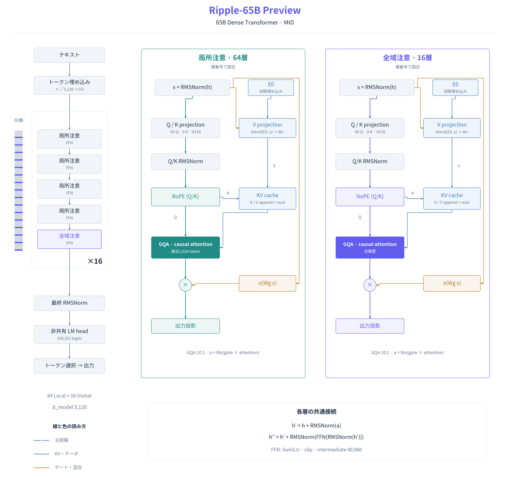

# Architecture Explainer

A Codex skill for turning source-backed model and system architectures into PNG and editable SVG diagrams. It supports three levels of detail, five palettes, and collision-checked arrow routing.

モデルやシステムの構成を、根拠に基づいて図解する Codex スキルです。small・mid・large の作例を同梱しています。



## Install in Codex

```sh
mkdir -p ~/.codex/skills
git clone https://github.com/kuraneko1/architecture-explainer.git ~/.codex/skills/architecture-explainer
```

Invoke `$architecture-explainer` with your model or system sources and your intended audience. Specify `small`, `mid`, or `large` to choose the level of detail. The workflow can use Archify and Benchmark Rebuild when those skills are installed. The included renderer runs independently.

## Render an example

The renderer uses Python 3, Matplotlib, Pillow, and the Noto Sans CJK JP font. From the repository root:

```sh
python3 -m venv .venv
.venv/bin/pip install matplotlib Pillow
.venv/bin/python scripts/diagram.py assets/examples/ripple-mid-ja.scene.json --out out/ripple-mid --palette jade-violet
.venv/bin/python scripts/check_routing.py
```

The renderer exports PNG, editable and outlined SVG, preview PNG, and JSON reports for geometry and validation. See the [renderer reference](references/rendering.md) for the scene format and the [palette preview](assets/palette-preview.png) for available colors.

## Examples

| Detail | Preview | Editable scene |
| --- | --- | --- |
| Small | [Overview](assets/examples/ripple-small-ja-preview.png) | |
| Mid | [Attention mechanisms](assets/examples/ripple-mid-ja-preview.png) | [JSON](assets/examples/ripple-mid-ja.scene.json) |
| Large | [Layer internals](assets/examples/ripple-large-ja-preview.png) | [JSON](assets/examples/ripple-large-ja.scene.json) |

The Ripple examples depict the [Ripple-65B Preview model](https://huggingface.co/ricursiveAI/Ripple-65B-Preview). The separate [QSA reference](assets/reference-qsa.png) illustrates the visual style.
